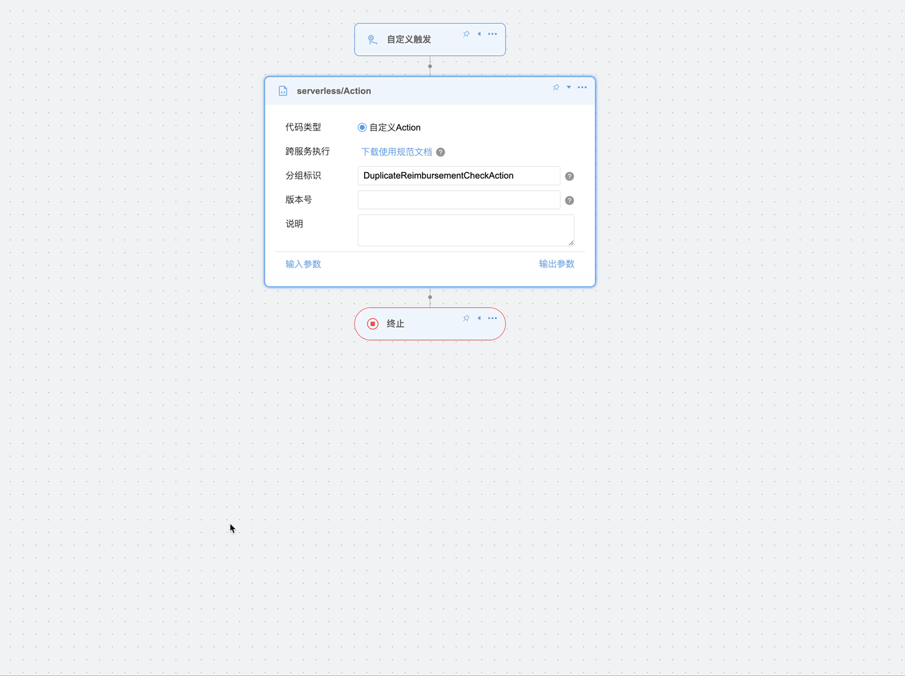

<h1 align="center">泛微 E10 工具</h1>

<strong>让 E10 实施与二次开发更方便。</strong>

为泛微 E10 提供工具应用，包含 E-code 前端及配套后端接口。

  <a href="docs/action-params.md">Action 参数自动获取</a> ·
  <a href="docs/form-assistant.md">流程表单助手</a> ·
  <a href="docs/developer-tools.md">开发者工具</a> ·
  <a href="#许可证">许可证</a>

## 工具应用

| 应用 | 简介 | 详细说明 |
| --- | --- | --- |
| 动作流 Action 参数自动获取 | 从 Action 类读取输入、输出参数，补充参数表格，支持循环内 Action、数组和缺失参数提示。 | [使用要求、参数示例及接口](docs/action-params.md) |
| 流程表单助手 | 查看和编辑工作流与 EB 表单字段，支持字段搜索、明细增删及删除日志。仅限管理员使用。 | [功能、配置及接口](docs/form-assistant.md) |
| 开发者工具 | 提供独立工具页面，目前支持查询和修改二开日志级别配置。 | [页面地址、日志配置及依赖](docs/developer-tools.md) |

## 如何部署
**后端源码部署：**  

提供两种方式：  
1. 通过本项目的 build.zip 包，通过上传 jar 包方式部署到系统中
2. 将本项目的源码放入你的 E10 开发环境中（开发环境需要自己搭建），然后你再打包，通过上传 jar 包方式部署到系统中，
使用此方式时，你还需要放入我的另一个项目的源码到你的项目中，项目地址：[https://github.com/YaoLilin/weaver-e10-second-dev-common](https://github.com/YaoLilin/weaver-e10-second-dev-common)

**前端 ecode 应用部署**：  
从 [resources](resources) 下载对应 E-code 应用 ZIP，导入系统后发布。若修改了应用源码，发布前使用 `ecodecmd build <应用目录> --target e10` 重新生成对应 ZIP。

## 动作流 Action 参数自动获取
你可以通过按钮，根据 Action 后端代码中定义的 Action 参数，一键自动获取参数添加到 Action 组件参数配置列表中，
无需再手动添加参数。  

- 可正确识别参数类型，包括 JSON 对象、JSON 数组、文本数组、数字、布尔类型等
- 可识别参数是否必填（是否必填在后端 Action 参数中定义）
- 可自动获取参数的显示名称、描述信息（这些信息在后端 Action 参数中定义）
- 如果前端缺少参数配置，可进行提示

**使用前提：**  
后端 Action 类必需继承此类 `AbstractEsbAction` 以及使用 `@ActionParam` 注解定义 Action 参数，
前端才能获取 Action 参数，这些类和注解都来源于我的另一个项目，需要将此项目作为依赖导入到你的开发项目中，
项目地址：https://github.com/YaoLilin/weaver-e10-second-dev-common

