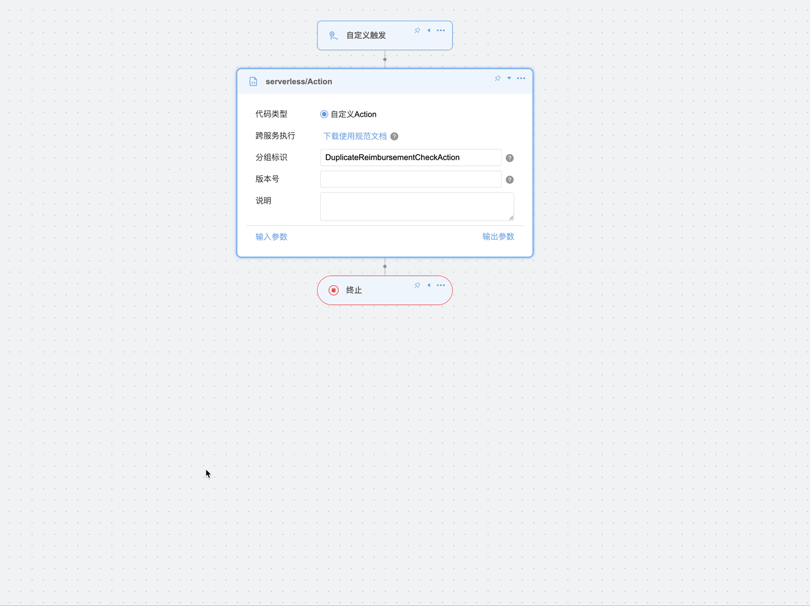

# 动作流 Action 参数自动获取开发说明

## 作者信息
作者：姚礼林  
日期：2026-07-13

## 功能说明
在动作流设计器的 Serverless/Action 组件参数配置对话框中，增加“获取参数”按钮。按钮会根据当前对话框标题自动识别输入参数或输出参数，调用后端接口获取 Action 类定义的参数，并补充或更新参数表格。

支持普通参数、嵌套对象、List 和 Java 数组；支持循环及嵌套循环内的 Action。对象子属性按树形结构写入表格，数组勾选由后端 `array` 标记决定。Integer 映射为整数，Float、Double、BigDecimal 映射为浮点数；Long 由当前后端按文本返回，避免长整型 ID 精度丢失。

组件加载后检查缺失参数：

- 缺少必填参数：显示“Action 参数存在必填参数缺失，请点击‘获取参数’按钮进行补充”。
- 仅缺少非必填参数：显示“当前缺少非必需参数，可点击获取参数按钮添加参数”。
- 两类同时缺失时优先提示必填参数；获取成功后清除提示。

已有同名参数会更新类型、数组标记与参数键，并保留已有参数 ID。

参数获取接口：

- 输入参数：`GET /api/secondev/esb/action/params/input?groupId={groupId}`
- 输出参数：`GET /api/secondev/esb/action/params/output?groupId={groupId}`

`groupId` 为 Action 类 `@Service` 注解中的名称。Action 类需要继承 `AbstractEsbAction`，并为泛型参数指定具体对象类型。



## 部署依赖

后端参数查询接口、解析器和 DTO 位于本仓库 `src/main/java`，并依赖 common 提供的 `AbstractEsbAction`、注解及泛型解析工具。需同时部署支持 Java 数组的后端实现与本 E-code 应用，不能仅更新前端。

构建与部署见[仓库说明](../README.md#构建与部署)。将本应用构建所得 ZIP 导入 E10 E-code 并发布。

## Action 定义与查询接口

继承 `AbstractEsbAction` 的 Action 可通过参数查询接口自动解析输入、输出参数，用于动作流参数配置页面自动填充参数表格。

**使用要求**：

- Action 必须使用 `@Service("ActionGroupId")` 声明 Bean 名称；`ActionGroupId` 即接口中的 `groupId`。
- `AbstractEsbAction` 的输入、输出泛型必须为具体对象类型，不能使用 `Object`、`Map` 或未指定的泛型。
- 可在字段上使用 `@ActionParam` 定义显示名称、描述、是否必填和默认值。
- 支持普通字段、嵌套对象、List 和 Java 数组（如 `String[]`）；对象元素的字段会作为子参数返回。

**参数定义示例**（仅展示字段定义，省略 Action 执行方法）：
```java
@Service("ExampleAction")
public class ExampleAction extends AbstractEsbAction<ExampleAction.InputParams, ExampleAction.OutputParams> {

    @Data
    public static class InputParams {
        @ActionParam(required = true, displayName = "流程请求ID", desc = "流程请求记录ID")
        private Long requestId;

        @ActionParam(displayName = "明细数据", desc = "报销明细列表")
        private List<DetailData> detailDataList;
    }

    @Data
    public static class DetailData {
        @ActionParam(required = true, displayName = "用户ID")
        private Long userId;
    }

    @Data
    public static class OutputParams {
        @ActionParam(displayName = "处理结果")
        private String result;
    }
}
```

**查询接口**：

| 参数类型 | 请求地址 |
|--------|----------|
| 输入参数 | `GET /api/secondev/esb/action/params/input?groupId=ExampleAction` |
| 输出参数 | `GET /api/secondev/esb/action/params/output?groupId=ExampleAction` |

接口统一返回 `WeaResult`。参数项包含 `name`、`showName`、`required`、`type`、`array`、`javaType`、`defaultValue`、`desc` 和 `children`；`children` 用于表示嵌套对象、List 对象或对象数组的子参数。


## 二开说明
接口拦截：

- 拦截 `/api/bs/esb/setting/flow/design/getDesignBySceneId/{sceneId}`，读取动作流设计数据中的 `actions`，用于根据当前组件 `wId` 获取对应 Action 的 `groupId`。

组件参数重写：

- 重写 `Dialog` 组件参数，在打开 Serverless/Action 组件配置对话框时读取当前 `wId`。

组件替换：

- 替换 `EditableTable` 组件。仅在动作流设计器中、当前组件为 Serverless/Action 参数表格时，使用 `ActionParamTable` 包装原表格；其他场景继续使用原组件。


[返回仓库首页](../README.md)
