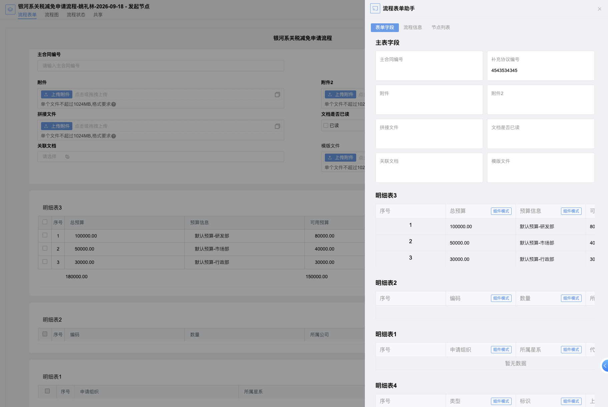
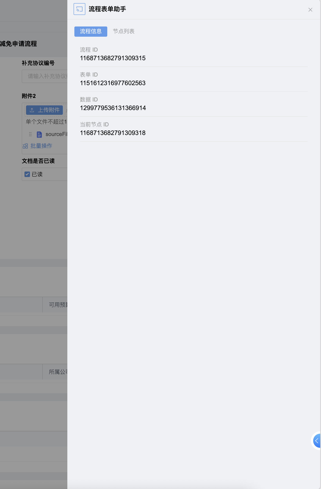

# 流程表单助手开发说明

## 作者信息

作者：姚礼林  
日期：2026-09-24

## 功能说明
表单助手支持工作流表单与 EB 表单，便于实施人员查看完整字段和已保存的字段值。
```text
⚠️ 注意：仅限管理员使用，不得开放给普通用户,请在该 ecode 应用设置生效范围，只限管理员角色
```

流程表单页面右下角提供可拖动的入口按钮。点击入口后，从右侧打开流程表单助手抽屉。

抽屉包含以下标签页：

- 表单字段：首个标签页。搜索框位于主表字段上方，同时搜索主表和明细字段的中文名称、数据库列名、字段 ID 和字段值；命中明细字段时，仅显示包含命中列的明细表，并保留表格行。主表字段分为“有值字段”和“无值字段”两组，默认只展开有值组，可手动展开无值组；搜索命中无值字段时自动显示无值组。主表采用随抽屉宽度自动扩展的网格，明细表采用与流程明细一致的表格样式。主表字段和明细列默认使用只读组件模式，切换按钮显示当前模式及切换图标；布局内字段沿用表单组件配置，布局外字段尝试使用后端字段元数据中的组件配置及值展示组件，配置或组件值不可用时回退为只读文本框。文本模式显示数据库原始值，如附件 ID，而非文件名。无数据的明细表仍展示全部列标题，表体显示“暂无数据”。
- 流程信息：展示当前流程的流程 ID、表单 ID、数据 ID 和当前节点 ID。
- 节点列表：展示当前流程全部节点的名称和 ID。

悬浮入口会记住用户最后一次拖动位置；点击抽屉外部遮罩、关闭按钮或按 Esc 均可关闭抽屉。

生效范围：PC 端流程表单页面 `/sp/workflow/flowpage/...`，以及 EB 表单卡片页面 `/sp/ebdfpage/card/...`。应用发布范围需同时覆盖这两类页面，并继续限制为管理员角色。

EB 页面显示“EB 表单助手”，支持相同的主表、明细、字段搜索、文本/组件切换及明细分页。EB 的“表单信息”展示表单名称、应用 ID、表单 ID、数据 ID，不展示工作流节点。字段列表包含未铺入布局的字段；取值为已保存记录的数据，尚无数据 ID 的新建表单不能查询完整字段值。

每张明细表独立分页：超过 50 行时，每页显示 50 行，可切换页码或输入页码直接跳页；50 行及以下不显示分页栏。翻页后序号连续，字段仍对应原明细行。分页范围为接口实际返回的明细数据。

关联文档使用平台文档阅读对话框打开。助手通过流程表单 Route 保留当前流程路径，字段组件复用当前表单的 `formProps`，由平台携带流程关联信息及当前文档鉴权参数；不自行拼接文档链接或保存鉴权值。


  


下图为此前的表单字段页面；本次搜索位置、明细列筛选与组件显示效果需在部署生效后重新截图：  


  


「流程信息」标签页：  




## 配置说明

修改本应用的 `/config/config.js` 文件。

配置示例：

```javascript
export default {
    drawerWidth: '40%',
};
```

- `drawerWidth`：抽屉宽度，支持百分比，如 `'40%'`；也支持像素值，如 `'480px'`。

## 数据获取说明

打开助手时保存当前表单 SDK 实例，后续字段渲染使用该实例。接口参数增加 `module`，取当前 SDK 的 `getBaseInfo().module`：工作流为 `workflow`，EB 为 `ebuilderform`。后端按模块查询字段库及组件元数据，EB 字段值通过通用表单数据服务的 `getFullFormData` 取得；不依赖当前页面布局过滤字段。

流程信息从当前流程表单 SDK 的基础信息中读取：

- 流程 ID：`customParam.workflowId`
- 表单 ID：`formId`
- 数据 ID：`dataId`
- 当前节点 ID：`customParam.nodeId`

表单字段使用 `devRequest` 请求后端接口 `GET /api/secondev/hnweaver/form-assist/field-value?formId={formId}&dataId={dataId}&module={module}`。该接口从表单字段库读取字段定义，并通过 `getFieldMapByFormId` 补充数据库列名及组件配置，再查询当前表单数据，包含未铺入布局的主表字段和明细列；主表字段由 `mainFields` 返回，明细表通过 `detailTables[].columns` 和 `detailTables[].rows[].fields` 返回。主表使用 `hasValue` 分组，主表及明细列搜索均匹配 `title`、`columnName`、`fieldId`、字段值与 `dataKey`，明细行中的值也参与其所属列的匹配。文本模式优先显示 `value.content`，为空时使用 `optionId`、`dataOptions[].optionId` 或附件 `fileId`；组件模式优先使用表单 SDK 的字段配置及 `formStore` 组件值，SDK 无字段配置时使用上述后端接口返回的 `componentConfig` 和字段值构造只读 `FormSwitch` 参数。布局外附件字段从后端返回的 `dataOptions` 取得文件 ID、名称及受限的文件属性；平台元数据未提供有效组件配置时回退为只读文本。布局外字段的具体显示效果需在后端部署后于目标页面验证。

接口服务端仅允许系统管理员调用。部署时还需在 E-code 前端二开准入名单中允许调用 `/api/secondev/hnweaver/form-assist/field-value`。

节点列表使用当前流程 ID 请求 `/api/bs/workflow/pathdef/nodeBase/getNodeList`，展示返回节点的 `id` 和 `nodeName`。

## 接口说明

### 查询表单全部字段与已保存值

| 项目 | 说明 |
| --- | --- |
| 请求方式 | `GET` |
| 接口路径 | `/api/secondev/hnweaver/form-assist/field-value` |
| 参数位置 | URL 查询参数（Query），无请求体 |
| 身份要求 | 已登录的系统管理员；使用当前登录用户查询，不使用其他管理员身份兜底 |
| 前端调用要求 | 通过 `devRequest` 调用，并配置 E-code 前端二开请求准入名单 |
| 适用范围 | 工作流表单、EB 表单；返回字段库中的字段定义及已保存记录的值，包含未铺入当前布局的字段 |

#### 请求参数

| 参数 | 类型 | 必填 | 说明 |
| --- | --- | --- | --- |
| `formId` | 十进制 ID 字符串，后端接收为 `Long` | 是 | 表单 ID，取当前表单 SDK 的 `getBaseInfo().formId` |
| `dataId` | 十进制 ID 字符串，后端接收为 `Long` | 是 | 已保存记录的数据 ID，取 `getBaseInfo().dataId`，不能用流程定义 ID 或表单 ID 代替 |
| `module` | string | 否 | 表单类型，仅支持 `workflow`、`ebuilderform`；省略时默认为 `workflow`，区分大小写 |

未保存的新建表单没有有效数据 ID，不能用此接口读取完整记录；页面尚未保存的修改也不属于接口返回值。

请求示例（工作流）：

```http
GET /api/secondev/hnweaver/form-assist/field-value?formId=1001&dataId=2001&module=workflow
```

EB 表单将 `module` 改为 `ebuilderform`。下面的 JSON 仅表示调用参数对象，不是 GET 请求体：

```json
{
  "formId": "1001",
  "dataId": "2001",
  "module": "ebuilderform"
}
```

#### 返回参数

接口以平台 `WeaResult` 包装。以下列出调用方使用的主要属性；平台可能额外返回 `code` 等属性，不应只根据 HTTP 状态判断业务是否成功。

| 属性 | 类型 | 说明 |
| --- | --- | --- |
| `status` | boolean | `true` 为查询成功，`false` 为失败 |
| `fail` | boolean | 是否失败，与 `status` 对应 |
| `msg` | string / null | 结果消息；失败时用于说明原因，成功时文案由平台决定 |
| `data` | object / null | 成功时为下述表单字段数据；失败时不可当作有效数据读取 |

**表单字段数据 `data`**

| 属性 | Java 类型 / JSON 结构 | 说明 |
| --- | --- | --- |
| `formId` | Long | 表单 ID |
| `dataId` | Long | 已保存记录的数据 ID |
| `mainFields` | FormFieldDTO[] | 主表字段定义及字段值，包含未铺入布局的字段 |
| `detailTables` | FormDetailTableDTO[] | 明细表分组，包含未铺入布局的明细列 |

**明细表 `detailTables[]`**

| 属性 | 类型 | 说明 |
| --- | --- | --- |
| `subFormId` | string | 明细表 ID |
| `title` | string | 后端返回的明细表名称 |
| `columns` | FormFieldDTO[] | 明细列定义；具体行值读取 `rows[].fields`，不能将列定义当作行值 |
| `rows` | FormDetailRowDTO[] | 按 `dataIndex` 排序的明细行；每张表最多返回 1000 行 |
| `totalRows` | integer | 截断前的实际明细行总数 |
| `truncated` | boolean | 超过 1000 行时为 `true`，`rows` 仅保留前 1000 行；不能通过请求参数调大上限 |

**明细行 `detailTables[].rows[]`**

| 属性 | Java 类型 / JSON 结构 | 说明 |
| --- | --- | --- |
| `dataIndex` | Long | 明细行索引；用于关联该行各字段值 |
| `rowId` | Long / null | 明细行 ID；与行索引不同 |
| `fields` | FormFieldDTO[] | 与所属明细表 `columns` 一一对应的字段副本，附带该行字段值 |

**字段对象 `FormFieldDTO`**（用于 `mainFields[]`、`columns[]` 和 `rows[].fields[]`）

| 属性 | 类型 | 说明 |
| --- | --- | --- |
| `fieldId` | string | 字段 ID，后端明确以字符串返回 |
| `dataKey` | string | 字段数据标识；不保证与数据库列名相同 |
| `columnName` | string / null | 数据库列名，从平台字段元数据补充；可能为空。助手展示时还会读取 `componentConfig.columnName`，不能把 `dataKey` 直接视为数据库列名 |
| `title` | string | 字段名称 |
| `componentKey` | string / null | 平台组件标识，如 `Text`、`FileComponent` |
| `componentConfig` | object / null | 平台字段组件配置；无配置或配置无效时为空，内部属性随组件类型变化，不是固定 DTO |
| `type` | string / null | 字段类型，如 `Text`、`Number`、`Image` |
| `subFormId` | string / null | 所属明细表 ID，主表字段为空 |
| `showOrder` | number / null | 字段显示顺序 |
| `required` | boolean / null | 是否必填 |
| `hasValue` | boolean / null | 是否取得非空展示文本；主表及明细行字段按 `value.displayText` 判断，明细列定义本身不表示某一行是否有值 |
| `value` | FormFieldValueDTO / null | 字段值；未取到值时为空，明细列定义不携带具体行值 |

**字段值 `FormFieldValueDTO`**

| 属性 | Java 类型 / JSON 结构 | 说明 |
| --- | --- | --- |
| `fieldId` | string | 对应字段 ID |
| `dataIndex` | Long / null | 明细行索引，主表字段为空 |
| `rowId` | Long / null | 明细行 ID，主表字段为空 |
| `content` | string / null | 原始值；可为空，不能只据此判断字段是否有值 |
| `optionId` | string / null | 选项 ID |
| `dataOptions` | FormFieldOptionDTO[] | 平台字段选项；附件 ID 与组件文件属性主要从这里返回。每个字段最多投影 1000 个选项 |
| `displayText` | string | 服务端计算的展示文本，依次优先取选项内容、文本内容、附件文件名、原始值 |
| `files` | FormFileDTO[] | 从平台 `fileDetails` 投影的文件列表，不含文件二进制内容；附件组件也可能仅通过 `dataOptions` 返回文件信息 |

**选项 `dataOptions[]` 与文件 `files[]`**

| 对象 | 属性 | Java 类型 / JSON 结构 | 说明 |
| --- | --- | --- | --- |
| 选项 | `optionId` | string | 选项 ID，明确以字符串返回 |
| 选项 | `content` | string / null | 选项显示内容 |
| 选项 | `type` | string / null | 平台选项类型，如 `file`；取平台枚举名称 |
| 选项 | `optionObj` | object / null | 文件类选项的白名单属性，非文件类通常为空；可能包含 `id`、`fileid`、`name`、`type`、`size`、`url`、上传信息及只读操作 `options`，不直接序列化整个平台对象 |
| 文件 | `fileId` | Long | 文件 ID |
| 文件 | `fileName` | string / null | 文件名称 |
| 文件 | `fileUrl` | string / null | 平台返回的文件访问地址；访问仍受平台权限控制 |

ID 在前端传参、保存和比较时应作为文本处理，避免 JavaScript 大整数精度丢失。上表标注 `Long` 的字段，其实际 JSON 数字/字符串形态由部署环境的序列化配置决定；以下示例的 ID 统一写成字符串，行索引写成数字，仅演示结构。可空属性也可能因平台序列化配置而省略。示例使用虚构 ID 和业务值。

#### 成功 JSON 示例

```json
{
  "status": true,
  "fail": false,
  "data": {
    "formId": "1001",
    "dataId": "2001",
    "mainFields": [
      {
        "fieldId": "3001",
        "dataKey": "contract_no",
        "columnName": "contract_no",
        "title": "合同编号",
        "componentKey": "Text",
        "componentConfig": {
          "fieldId": "3001",
          "dataKey": "contract_no",
          "columnName": "contract_no",
          "type": "Text",
          "readOnly": true
        },
        "type": "Text",
        "subFormId": null,
        "showOrder": 1.0,
        "required": true,
        "hasValue": true,
        "value": {
          "fieldId": "3001",
          "dataIndex": null,
          "rowId": null,
          "content": "HT-001",
          "optionId": null,
          "dataOptions": [],
          "displayText": "HT-001",
          "files": []
        }
      }
    ],
    "detailTables": [
      {
        "subFormId": "4001",
        "title": "费用明细",
        "columns": [
          {
            "fieldId": "3002",
            "dataKey": "item_name",
            "columnName": "item_name",
            "title": "项目名称",
            "componentKey": "Text",
            "componentConfig": null,
            "type": "Text",
            "subFormId": "4001",
            "showOrder": 1.0,
            "required": false,
            "hasValue": false,
            "value": null
          }
        ],
        "rows": [
          {
            "dataIndex": 1,
            "rowId": "5001",
            "fields": [
              {
                "fieldId": "3002",
                "dataKey": "item_name",
                "columnName": "item_name",
                "title": "项目名称",
                "componentKey": "Text",
                "componentConfig": null,
                "type": "Text",
                "subFormId": "4001",
                "showOrder": 1.0,
                "required": false,
                "hasValue": true,
                "value": {
                  "fieldId": "3002",
                  "dataIndex": 1,
                  "rowId": "5001",
                  "content": "服务费",
                  "optionId": null,
                  "dataOptions": [],
                  "displayText": "服务费",
                  "files": []
                }
              }
            ]
          }
        ],
        "totalRows": 1,
        "truncated": false
      }
    ]
  }
}
```

`componentConfig` 示例仅展示部分属性；空值字段可返回 `hasValue: false`、`value: null`，无数据的明细表可返回 `rows: []`。助手每页 50 行的分页只针对已返回的行，不会继续请求被后端截断的部分。

#### 失败说明与 JSON 示例

| 场景 | 当前实现的错误信息 |
| --- | --- |
| 服务层未取得登录用户 | `接口需登录后调用`（也可能先被平台登录层拦截） |
| 非系统管理员 | `仅系统管理员可调用该接口` |
| 不支持的模块 | `不支持的表单类型：{module}` |
| 表单字段库为空 | `未查询到表单字段，formId={formId}` |
| 已保存记录不存在 | `未查询到表单数据，dataId={dataId}` |
| EB 表单数据服务不可用 | `未找到 EB 表单数据服务` |

Controller 将服务查询异常转换为 `WeaResult.fail`。以下为主要业务属性示例，平台可能附加错误码或其他字段：

```json
{
  "status": false,
  "fail": true,
  "msg": "仅系统管理员可调用该接口"
}
```

缺少必填参数或 `formId`、`dataId` 不能解析为 `Long` 时，由 Spring MVC 参数绑定层处理，不保证返回上述业务失败结构。

本章节依据本仓库的 `FormAssistController`、`FormAssistModule`、`formassist/domain/dto` 及字段数据组装实现编写。节点列表使用前述平台标准接口，不属于本仓库新增的后端接口。

## 实现说明

### 让助手字段与表单布局内的字段显示一致

助手通过复用平台字段组件、当前表单的字段配置和组件值，让布局内字段沿用原表单的展示方式，而不是根据字段类型重新拼接文本或自建一套展示组件。这里的一致指字段组件及其显示内容；助手采用自己的主表卡片和明细表格排列，不复制原表单的整体布局，并统一禁止编辑。

#### 绑定当前表单实例

打开助手时，`FlowFormAssistant` 保存当前表单 SDK 实例，字段配置、组件值、明细行 ID 和表单上下文都从该实例取得。独立页面使用 `window.WeFormSDK.getWeFormInstance()`；EB 侧栏及弹窗通过 `onFormReady` 事件取得当前表单的 `formSdk`，以 `initialFormSdk` 传入助手，避免读取到其他已打开表单。

后端字段查询使用同一实例基础信息中的 `formId`、`dataId`、`module`，使完整字段库与当前记录对应。后端返回已保存值；布局内字段的组件模式优先读取当前表单实例中的组件值，因此原表单尚未保存的修改与后端返回值可能不同。

#### 复用布局内的字段配置和组件值

字段展示入口为 `components/FormFieldValue.js`，处理步骤如下：

1. 通过 `formSdk.getFieldInfo(field.id)` 取得当前字段配置，保留原组件配置，额外设置 `readOnly: true`、`disabled: true`，确保助手只读。
2. 主表字段直接调用 `formSdk.weFormApi.formStore.getWidgetData(field.id, rowId)` 读取平台组件所需的完整值对象，此时 `rowId` 不传。
3. 明细字段先通过 `formSdk.getDetailRowIdByIndex(field.subFormId, rowIndex)` 获取当前表单的明细行 ID，再将字段 ID 与行 ID 一起传给 `getWidgetData`。明细分页传入包含分页偏移的行号，不使用页内序号，避免翻页后取到其他行的值。
4. 使用 `@weapp/ui` 的 `CorsComponent` 加载 `@weapp/formbuilder` 的 `FormSwitch`，传入字段配置、完整组件值和行 ID，由平台决定日期、金额、选项、浏览框、附件等字段的具体展示。
5. 同时传入当前实例的 `formSdk.weFormApi.formStore.formProps`，保留当前表单的关联对象、模块及字段上下文。关联文档等操作由平台组件处理，不自行拼接文档地址或构造鉴权参数。

布局内字段的关键渲染参数如下，`componentDefinition` 和 `componentData` 均由上述步骤生成：

```javascript
<CorsComponent
    app="@weapp/formbuilder"
    compName="FormSwitch"
    config={componentDefinition.config}
    formProps={formSdk.weFormApi.formStore.formProps}
    isNewDataFormat
    onBlur={() => {}}
    onChange={() => {}}
    rowId={componentData.rowId}
    value={componentData.value}
/>
```

使用完整组件值而非仅传 `content`，可以保留选项、浏览字段及附件组件需要的结构。`onChange`、`onBlur` 不执行写回，配合只读配置，助手不修改表单值。工作流独立页面还通过匹配当前流程路径的 `Route` 保留路由上下文，供平台关联文档等功能使用。

#### 布局外字段和文本模式的处理

字段清单来自后端完整字段库，不能仅依赖 `getFieldInfo` 获取所有字段。字段未铺入布局、SDK 无字段配置时，助手使用接口返回的 `componentKey` 和 `componentConfig` 构造只读配置，并设置 `display: true`、`show: true`；组件值由后端的 `value`、`dataOptions` 等属性组装。后端组件配置从平台字段元数据的布局明细 `config` 或扩展属性中提取。

组件配置不可用、SDK 组件值读取失败或无法取得对应明细行时，回退到只读 `Input`。文本模式优先读取后端原始值，按 `content`、`optionId`、`dataOptions[].optionId`、附件 `fileId` 的顺序选择展示内容；后端值为空时再尝试读取 SDK 原始值。文本模式用于查看原始数据，例如附件 ID，不承诺与原表单中格式化后的组件内容相同。

#### 一致性的适用边界

复用平台组件可以沿用原字段的展示规则，但当前实现不能保证所有组件在助手内完全一致：人员、部门等复杂浏览字段还可能依赖原表单的组件子节点或内部上下文，字段值对象存在也不代表界面一定正确回显。布局外字段没有原布局组件可供直接复用，其展示还依赖后端元数据是否完整。

验证时应在同一表单、同一记录下逐项对照原表单与助手的组件显示内容，重点检查浏览字段、日期、金额、附件、关联文档及明细分页后的行值；不能仅以 `FormSwitch` 已挂载或接口返回成功判断显示一致。若平台组件缺少必要上下文，应针对实际组件核实依赖后修复，不能通过强制显示原始 ID 来宣称与原表单一致。

## 部署说明

1. 联系开发人员获取 tools 模块的最新 jar 包，在 `/ecode/monitor/loom/deploy/jar` 页面中部署此 jar 包。部署 jar 包后重启二开服务；如同时修改二开服务配置文件，也需重启使配置生效。
2. 将交付的 Ecode 应用导入到系统中，导入后请查看 Ecode 应用内的 README 文档进行配置。先完成后端部署，再发布“流程表单助手”应用，确保后端支持 `module=workflow` 和 `module=ebuilderform`。
3. 在 E-code 前端二开准入名单中允许调用 `/api/secondev/hnweaver/form-assist/field-value`，并将助手应用限制为管理员角色使用。
4. 应用生效范围需覆盖工作流表单页面、EB 独立卡片页面，以及通过侧栏或弹出窗口打开 EB 表单的列表页面；仅配置独立卡片页面不能覆盖列表内打开表单的场景。
5. 按本文“配置说明”设置应用的 `config/config.js`，然后发布应用并刷新对应页面。


[返回仓库首页](../README.md)
